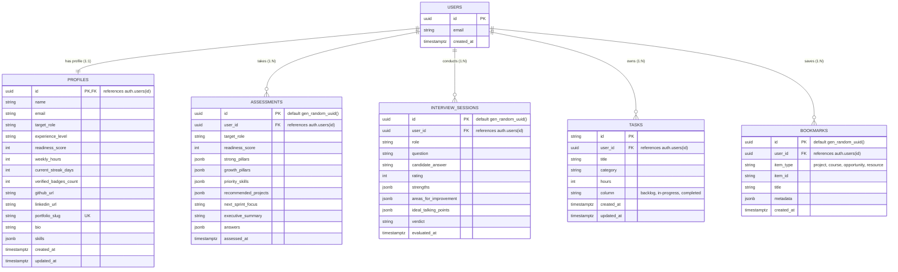

# TALVIORA TECH: Database Architecture & Schema Specification

**Document Version:** 1.0.0  
**Database Engine:** PostgreSQL 15+ (Hosted on Supabase)  
**Schema File:** [`supabase/schema.sql`](file:///c:/Users/Asus/OneDrive/Desktop/AI%20CAREER%20INTELLIGENCE%20PLATFORM/supabase/schema.sql)  
**Security Model:** Mandatory Row Level Security (RLS) with Cryptographic User Isolation  

---

## 1. Entity-Relationship Diagram (ERD)

---

## 2. Table Specifications

### 2.1 Table: `public.profiles`
Stores learner bio, contact links, target role, pace, and verified technical skills.

| Column | Data Type | Constraints | Description |
|---|---|---|---|
| `id` | `UUID` | `PRIMARY KEY REFERENCES auth.users(id) ON DELETE CASCADE` | Matches the authenticated user ID. |
| `name` | `TEXT` | `NOT NULL DEFAULT 'Learner'` | Candidate full display name. |
| `email` | `TEXT` | Nullable | Primary contact email. |
| `target_role` | `TEXT` | `NOT NULL DEFAULT 'AI Solutions Architect'` | Selected target engineering position. |
| `experience_level` | `TEXT` | `CHECK (experience_level IN ('Entry', 'Junior', 'Mid-Level', 'Senior', 'Lead'))` | Seniority category. |
| `readiness_score` | `INT` | `CHECK (readiness_score >= 0 AND readiness_score <= 100)` | Assessed readiness percentage. |
| `weekly_hours` | `INT` | `CHECK (weekly_hours >= 1 AND weekly_hours <= 100)` | Available weekly study hours. |
| `current_streak_days`| `INT` | `CHECK (current_streak_days >= 0)` | Consecutive daily study days. |
| `verified_badges_count`| `INT` | `CHECK (verified_badges_count >= 0)` | Number of verified skill badges earned. |
| `github_url` | `TEXT` | Nullable | Public GitHub profile URL. |
| `linkedin_url` | `TEXT` | Nullable | Public LinkedIn profile URL. |
| `portfolio_slug` | `TEXT` | `UNIQUE` | Vanity URL path (e.g. `/portfolio?slug=feriha`). |
| `bio` | `TEXT` | Nullable | Short candidate executive bio. |
| `skills` | `JSONB` | `NOT NULL DEFAULT '{}'::jsonb` | Key-value skill scores (0–100). |
| `created_at` | `TIMESTAMPTZ`| `DEFAULT NOW()` | Record creation timestamp. |
| `updated_at` | `TIMESTAMPTZ`| `DEFAULT NOW()` | Auto-updated via database trigger. |

---

### 2.2 Table: `public.assessments`
Stores technical assessment results, rubric pillars, recommended projects, and AI executive summaries.

| Column | Data Type | Constraints | Description |
|---|---|---|---|
| `id` | `UUID` | `PRIMARY KEY DEFAULT gen_random_uuid()` | Unique evaluation run identifier. |
| `user_id` | `UUID` | `REFERENCES auth.users(id) ON DELETE CASCADE` | Candidate foreign key. |
| `target_role` | `TEXT` | `NOT NULL` | Role evaluated for. |
| `readiness_score` | `INT` | `0 <= readiness_score <= 100` | Calculated readiness score. |
| `strong_pillars` | `JSONB` | `DEFAULT '[]'::jsonb` | High-scoring technical domains. |
| `growth_pillars` | `JSONB` | `DEFAULT '[]'::jsonb` | Areas requiring study focus. |
| `priority_skills` | `JSONB` | `DEFAULT '[]'::jsonb` | Urgent skills to master this sprint. |
| `recommended_projects`| `JSONB` | `DEFAULT '[]'::jsonb` | Tailored portfolio build suggestions. |
| `next_sprint_focus`| `TEXT` | Nullable | Primary objective for next sprint. |
| `executive_summary`| `TEXT` | Nullable | Comprehensive AI analysis narrative. |
| `answers` | `JSONB` | `DEFAULT '{}'::jsonb` | Raw candidate question selections. |
| `assessed_at` | `TIMESTAMPTZ`| `DEFAULT NOW()` | Evaluation timestamp. |

---

### 2.3 Table: `public.interview_sessions`
Records mock interview questions, candidate responses, ratings, and AI critiques.

| Column | Data Type | Constraints | Description |
|---|---|---|---|
| `id` | `UUID` | `PRIMARY KEY DEFAULT gen_random_uuid()` | Interview screening session ID. |
| `user_id` | `UUID` | `REFERENCES auth.users(id) ON DELETE CASCADE` | Candidate foreign key. |
| `role` | `TEXT` | `NOT NULL` | Interview role context. |
| `question` | `TEXT` | `NOT NULL` | Prompt or system architecture challenge. |
| `candidate_answer`| `TEXT` | `NOT NULL` | Candidate technical response. |
| `rating` | `INT` | `CHECK (rating >= 1 AND rating <= 10)` | Evaluator score (1–10). |
| `strengths` | `JSONB` | `DEFAULT '[]'::jsonb` | Positive talking points identified. |
| `areas_for_improvement`| `JSONB`| `DEFAULT '[]'::jsonb` | Gaps or missed trade-offs. |
| `ideal_talking_points`| `JSONB` | `DEFAULT '[]'::jsonb` | Industry best practices suggested. |
| `verdict` | `TEXT` | Nullable | Final evaluation verdict. |
| `evaluated_at` | `TIMESTAMPTZ`| `DEFAULT NOW()` | Screening timestamp. |

---

### 2.4 Table: `public.tasks`
Tracks sprint backlog items, hours, and Kanban column movements.

| Column | Data Type | Constraints | Description |
|---|---|---|---|
| `id` | `TEXT` | `PRIMARY KEY` | Task identifier (`task-timestamp` or UUID). |
| `user_id` | `UUID` | `REFERENCES auth.users(id) ON DELETE CASCADE` | Task owner foreign key. |
| `title` | `TEXT` | `NOT NULL` | Actionable task title. |
| `category` | `TEXT` | `DEFAULT 'General'` | Domain tag (Deep Learning, DevOps, etc.). |
| `hours` | `INT` | `1 <= hours <= 40` | Estimated study/build hours. |
| `"column"` | `TEXT` | `CHECK ("column" IN ('backlog', 'in-progress', 'completed'))` | Kanban column status (escaped reserved keyword). |
| `created_at` | `TIMESTAMPTZ`| `DEFAULT NOW()` | Task creation timestamp. |
| `updated_at` | `TIMESTAMPTZ`| `DEFAULT NOW()` | Last status update timestamp. |

---

## 3. Row Level Security (RLS) Model

Supabase enables PostgreSQL Row Level Security to strictly enforce tenant isolation:

1. **`profiles`:**
   * **Public Read:** `portfolio_slug IS NOT NULL` allows unauthenticated recruiters/mentors to view public proof-of-work profiles while protecting private columns.
   * **Owner Write:** `auth.uid() = id` prevents any user from modifying another candidate's profile.
2. **`assessments` & `interview_sessions`:**
   * **Private Access:** Strict `auth.uid() = user_id` ensures that candidates cannot access or manipulate other users' evaluation histories.
3. **`tasks` & `bookmarks`:**
   * **Owner Exclusive:** Only the task owner can read, insert, update, or delete personal sprint items.

---

## 4. Database Setup & Execution

To apply the schema to the Supabase database:
1. Log in to the [Supabase Dashboard](https://supabase.com/dashboard).
2. Open your project: `vxqpsuzmdjaqvvnqtfcv`.
3. In the left navigation, click **SQL Editor**.
4. Click **New Query**.
5. Copy and paste the entire contents of [`supabase/schema.sql`](file:///c:/Users/Asus/OneDrive/Desktop/AI%20CAREER%20INTELLIGENCE%20PLATFORM/supabase/schema.sql).
6. Click **Run** (or press `Ctrl+Enter`).
7. Verify that all 5 tables appear in the **Table Editor** with green RLS shields.
